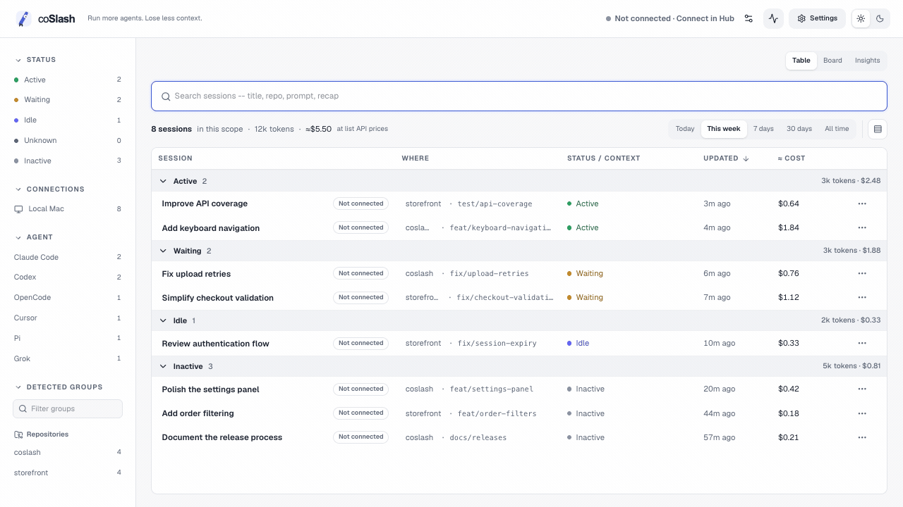

<p align="center">
  <a href="https://coslash.io"></a>
</p>

**Search and resume any agent session.**

[](https://github.com/centauri-ai/coslash/actions/workflows/ci.yml)
[](collector/go.mod)
[](frontend/.nvmrc)
[](https://github.com/centauri-ai/coslash/releases)
[](LICENSE)

coSlash brings your coding-agent sessions into one board: **every agent harness, every
machine, local or remote.** See which agents need you, catch up on what changed, and
resume work with context.

coSlash is free and open source under the [MIT license](LICENSE).

Search session content across all time in the app, or run
`coslash search "why did we choose the merge queue" --json` for ranked sessions
and decisions. Search runs locally without a model or API key.



## Why coSlash?

- **Know where to look.** See which sessions are active, waiting for your answer,
  or no longer running, across agents, machines, repositories, and branches. Add a
  remote host from your SSH config and its sessions join the same list.
- **Catch up without reading the whole transcript.** Open a session for its goal,
  decisions, changed files, subagents, and token and cost breakdowns. Each decision
  links to the turn it came from.
- **Pick up where you left off.** Resume the original session, start fresh with a
  handoff, or send the work to another installed agent.

**Supported agents:** Claude Code, Codex / ChatGPT, Cursor, OpenCode, Pi, and Grok Build.

**Early preview:** macOS, Linux (amd64 and arm64), and Windows 11 amd64. Agent capabilities vary by platform. See the [support table](docs/install.md#supported-agents-and-platforms) for desktop, CLI, and SSH support, including resume limitations.

## Get started

coSlash needs no account, Go, or Node installation.

**macOS / Linux**

```sh
curl -fsSL https://coslash.io/install.sh | bash
```

**Windows**

```powershell
irm https://coslash.io/install.ps1 | iex
```

After installation, run the startup command the installer prints.
coSlash opens its local UI in your browser.
See the [installation guide](docs/install.md) for Homebrew, headless servers, and updates.

coSlash needs at least one session from a supported agent.
If no sessions appear, take one turn in an agent inside a repository,
or run `coslash doctor` for diagnostics.
See [troubleshooting](docs/troubleshooting.md) for setup errors.

## Your data

coSlash needs no account and uses no telemetry.
It reads transcripts without changing them.

AI synthesis is off by default. If you enable it, coSlash sends derived session facts
through your chosen agent CLI and its account. Paid models can incur charges.
See [data and privacy](docs/data-and-privacy.md) for what leaves your machine,
local storage, and removal controls.

## More

- [Installation, updates, and uninstall](docs/install.md)
- [Agent skills and CLI commands](docs/agents.md)
- [AI synthesis and model options](docs/synthesis.md)
- [Troubleshooting](docs/troubleshooting.md)
- [Contributing and source builds](CONTRIBUTING.md)
- [Security policy](SECURITY.md) · [MIT license](LICENSE)

Bug reports are welcome through [Issues](https://github.com/centauri-ai/coslash/issues).
Redact transcripts, prompts, and private paths before posting.
Unsolicited pull requests are not accepted. See [Contributing](CONTRIBUTING.md) for the project policy.
